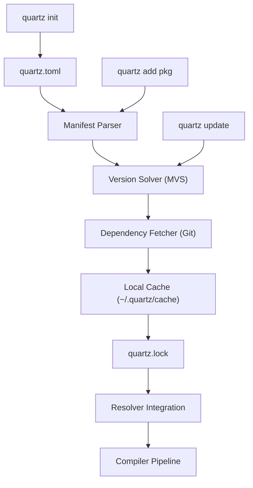

# E.2 — Package Manager: Full Implementation

## Goal

Build a complete package manager for Quartz: `quartz.toml` manifest, dependency resolution, lockfile, Git-based fetching, and registry protocol. The result should make Quartz usable for multi-crate projects with external dependencies — the single biggest gap between "works" and "you'd choose this for a project."

## Research Findings

### What the Major Players Do

| System | Manifest | Lock | Resolution | Registry | Source Strategy |
|---|---|---|---|---|---|
| **Cargo** (Rust) | `Cargo.toml` | `Cargo.lock` | Maximal + PubGrub (planned) | `crates.io` (centralized) | Download + compile from source |
| **Go Modules** | `go.mod` | `go.sum` (checksums) | Minimal Version Selection (MVS) | Decentralized (VCS URLs), optional proxy | Download from VCS |
| **Zig** | `build.zig.zon` | N/A (hashes inline) | Hash-locked references | No registry (URL-based) | Fetch tarball/zip by URL |
| **npm/pnpm** | `package.json` | `package-lock.json` | Maximal semver | `npmjs.com` (centralized) | Download tarball |
| **Swift PM** | `Package.swift` | `Package.resolved` | PubGrub | No central registry | Git repositories |
| **uv** (Python) | `pyproject.toml` | `uv.lock` | PubGrub | PyPI | Download wheels/sdists |

### What the Community Wants Most

1. **"Clone and play"** — `git clone && quartz build` must Just Work™
2. **Clear error messages** when deps conflict (PubGrub excels here)
3. **Reproducible builds** via lockfiles with integrity hashes
4. **Offline support** — a global cache that avoids re-downloading
5. **Workspace/monorepo** support for multi-package projects
6. **Fast resolution** — sub-second for typical dependency graphs
7. **Security** — hash verification, no silent dependency mutations

### Key Design Decision: MVS over Maximal

> [!IMPORTANT]
> **We choose Go-style Minimal Version Selection (MVS)** over Cargo-style maximal version selection.

**Rationale**: MVS is simpler to implement (no backtracking, no NP-hard solver), produces reproducible builds without a lockfile (though we still generate one for integrity), and avoids surprise dependency upgrades. For a young ecosystem, MVS is strictly better — there are no "diamond dependency problems" when the ecosystem is small, and MVS prevents the accidental breakage that maximal selection causes. If/when the ecosystem grows to need it, we can add PubGrub as a resolver backend without changing the manifest format.

**Tradeoff acknowledged**: MVS means users won't automatically get bug fixes from transitive dependencies. This is intentional — explicit `quartz update` is required. This matches Go's philosophy of "boring, predictable builds."

### Key Design Decision: Git-first, Registry-ready

> [!IMPORTANT]
> **Phase 1 is Git-based (like Go, Swift PM, Zig). Phase 2 adds a registry index.**

Quartz doesn't have a package ecosystem yet. Building a registry server before there are packages to host is premature. Git-based deps work today, and the manifest format is designed to be forward-compatible with a future `quartz.pkg` registry.

### Key Design Decision: TOML Manifest

We use TOML because:
- Quartz already has a **complete TOML parser AND serializer** in stdlib
- Cargo and uv have proven TOML works for manifests
- It's human-readable and diff-friendly

---

## Architecture Overview



### File Layout

```
my-project/
├── quartz.toml          # Manifest (user-edited)
├── quartz.lock          # Lockfile (machine-generated, committed to VCS)
├── src/
│   └── main.qz         # Source code
├── deps/                # Downloaded dependencies (gitignored)
│   ├── json-parser/     # Checked-out dependency
│   │   ├── quartz.toml
│   │   └── src/
│   └── http-client/
│       ├── quartz.toml
│       └── src/
└── .quartz/
    └── cache/           # Global cache (shared across projects)
```

---

## Data Model

### `quartz.toml` Manifest Schema

```toml
[package]
name = "my-app"
version = "1.2.0"
authors = ["Alice <alice@example.com>"]
description = "A web application"
license = "MIT"
repository = "https://github.com/alice/my-app"
entry = "src/main.qz"       # Default: "src/main.qz". If main() exists → exe, else → lib

[dependencies]
json-parser = { git = "https://github.com/bob/json-parser", tag = "v1.0.0" }
http-client = { git = "https://github.com/alice/http-client", branch = "main" }
utils       = { path = "../shared/utils" }

# Future: registry-based deps
# math-extra = "^2.1.0"

[dev-dependencies]
test-helpers = { git = "https://github.com/test/helpers", tag = "v0.5.0" }

[build]
stdlib = true              # Include std/ in import paths (default: true)
opt-level = 2              # Default optimization level
overflow-checks = false    # Default: false
```

### `quartz.lock` Lockfile Schema

```toml
# Auto-generated by quartz. Do not edit.
[metadata]
version = 1
generated = "2026-02-25T21:31:00Z"

[[package]]
name = "json-parser"
version = "1.0.0"
source = "git+https://github.com/bob/json-parser?tag=v1.0.0"
commit = "abc123def456"
hash = "sha256:e3b0c44298fc1c149afbf4c8996fb92427ae41e4649b934ca495991b7852b855"

[[package]]
name = "http-client"
version = "0.3.2"
source = "git+https://github.com/alice/http-client?branch=main"
commit = "789abc012def"
hash = "sha256:d7a8fbb307d7809469ca9abcb0082e4f8d5651e46d3cdb762d02d0bf37c9e592"
dependencies = ["json-parser"]
```

### Key Abstractions

```
PackageManifest          — parsed quartz.toml
  .package: PackageInfo  — name, version, authors, entry point
  .deps: Vec<Dependency> — declared dependencies
  .dev_deps: Vec<Dependency>
  .build: BuildConfig    — compilation settings

Dependency               — a single dependency declaration
  .name: String
  .source: DepSource     — Git { url, tag/branch/rev } | Path { path } | Registry { version_req }

SemVer                   — parsed semantic version (major.minor.patch + pre-release + build)

VersionReq               — version constraint (^1.2, ~1.2.3, >=1.0 <2.0, =1.2.3)

ResolvedPackage          — fully resolved dependency
  .name: String
  .version: SemVer
  .source: String        — canonical source string
  .commit: String        — pinned Git commit
  .hash: String          — content hash
  .deps: Vec<String>     — transitive dependency names

LockFile                 — serializable Vec<ResolvedPackage>

DepGraph                 — adjacency list for resolved dependency tree
```

---

## Proposed Changes

### Component 1: Manifest & Lockfile Module (`std/pkg/`)

New standard library module for manifest parsing, lockfile I/O, and semantic versioning.

#### [NEW] [manifest.qz](file:///path/to/quartz-package-manager/std/pkg/manifest.qz)

- `PackageManifest`, `PackageInfo`, `Dependency`, `DepSource`, `BuildConfig` structs
- `manifest_parse(content: String): Result<PackageManifest, ParseError>` — parses `quartz.toml` content using existing `toml_parse`
- `manifest_load(dir: String): Result<PackageManifest, ParseError>` — reads `quartz.toml` from a directory
- `manifest_validate(m: PackageManifest): Result<Int, ParseError>` — validates required fields, name format, version format
- `manifest_generate(info: PackageInfo): String` — generates a default `quartz.toml` for `quartz init`

#### [NEW] [semver.qz](file:///path/to/quartz-package-manager/std/pkg/semver.qz)

- `SemVer` struct — `{ major: Int, minor: Int, patch: Int, pre: String, build: String }`
- `semver_parse(s: String): Result<SemVer, ParseError>` — parses "1.2.3", "1.2.3-beta.1", etc.
- `semver_cmp(a: SemVer, b: SemVer): Int` — three-way comparison (-1, 0, 1) per SemVer spec
- `semver_to_string(v: SemVer): String`
- `semver_satisfies(v: SemVer, req: VersionReq): Bool` — checks if version meets constraint
- `VersionReq` struct + `version_req_parse(s: String): Result<VersionReq, ParseError>` — ^, ~, >=, <, = operators

#### [NEW] [lockfile.qz](file:///path/to/quartz-package-manager/std/pkg/lockfile.qz)

- `ResolvedPackage`, `LockFile` structs
- `lockfile_load(path: String): Result<LockFile, ParseError>` — reads `quartz.lock`
- `lockfile_save(lock: LockFile, path: String): Result<Int, IoError>` — writes `quartz.lock` using `toml_stringify`
- `lockfile_is_stale(lock: LockFile, manifest: PackageManifest): Bool` — checks if lock matches manifest

#### [NEW] [resolver.qz](file:///path/to/quartz-package-manager/std/pkg/resolver.qz)

- `DepGraph` struct (adjacency list)
- `resolve(manifest: PackageManifest, lock: LockFile): Result<Vec<ResolvedPackage>, ResolveError>` — MVS algorithm
- `resolve_build_graph(packages: Vec<ResolvedPackage>): DepGraph` — topological sort
- `resolve_detect_cycles(graph: DepGraph): Result<Int, ResolveError>` — cycle detection via DFS

#### [NEW] [fetcher.qz](file:///path/to/quartz-package-manager/std/pkg/fetcher.qz)

- `fetch_git(url: String, ref: String, dest: String): Result<String, IoError>` — clone/checkout via `git` subprocess
- `fetch_ensure_cached(dep: Dependency, cache_dir: String): Result<String, IoError>` — check cache, fetch if missing
- `compute_dir_hash(path: String): String` — content hash of dependency source tree

#### [NEW] [pkg.qz](file:///path/to/quartz-package-manager/std/pkg/pkg.qz)

- Re-export module: `import * from pkg/manifest`, `import * from pkg/semver`, etc.

---

### Component 2: CLI Commands

Modifications to the compiler's CLI entry point and new command handlers.

#### [MODIFY] [quartz.qz](file:///path/to/quartz-package-manager/self-hosted/quartz.qz)

- Register new subcommands: `init`, `add`, `remove`, `update`, `deps`
- Modify `do_build` to detect `quartz.toml` in the current directory and auto-configure import paths from resolved dependencies
- Add `do_init`, `do_add`, `do_remove`, `do_update`, `do_deps` handler functions
- Import new `pkg` module functions

> [!WARNING]
> The compiler currently inlines argparse due to bootstrap limitations. The package manager commands will also be inlined. If this bloats `quartz.qz` beyond maintainability, we should extract a `cli.qz` module.

---

### Component 3: Resolver Integration

Wire resolved dependencies into the existing import resolution system.

#### [MODIFY] [resolver.qz](file:///path/to/quartz-package-manager/self-hosted/resolver.qz)

- Add a new search path category: dependency directories from `deps/`
- Enhance `resolve_load_module` to search dependency source directories
- No changes to the UFCS transformation or module prefixing logic — dependencies are just additional import paths

The integration is minimal: each resolved dependency contributes a `-I deps/<name>/src` include path. The existing resolver already handles `-I` paths correctly.

---

### Component 4: Content Hashing for Dependencies

#### [MODIFY] [content_hash.qz](file:///path/to/quartz-package-manager/self-hosted/shared/content_hash.qz)

- Add `content_hash_dir(path: String): String` — recursively hash all `.qz` files in a directory tree (for dependency integrity verification)

---

## Error Handling Strategy

All new functions return `Result<T, E>` using Quartz's existing `Result` enum and `ParseError`/`IoError` types from `std/error.qz`. User-facing error messages follow the Rust-style diagnostic format already established by `diagnostic.qz`.

Error codes:
- `QZ2001` — Invalid `quartz.toml` syntax
- `QZ2002` — Missing required manifest field
- `QZ2003` — Invalid semantic version
- `QZ2004` — Dependency not found (fetch failure)
- `QZ2005` — Dependency cycle detected
- `QZ2006` — Version conflict (no satisfying resolution)
- `QZ2007` — Lockfile integrity mismatch
- `QZ2008` — Invalid dependency source specification

---

## Genuine Tensions / Tradeoffs

### 1. MVS simplicity vs. PubGrub error quality
**Tension**: MVS is simpler to implement but produces worse error messages on version conflicts. PubGrub generates human-readable derivation trees.
**Decision**: Start with MVS. The ecosystem has <10 packages — version conflicts won't arise. When they do, we upgrade to PubGrub. The `resolve()` function is the only point that needs to change.
**World-class approach**: PubGrub algorithm implementation.
**Plan to get there**: Deferred to E.2b after the ecosystem has packages that actually conflict.

### 2. Git subprocess vs. libgit2 FFI
**Tension**: Shelling out to `git` is slower and less portable than linking libgit2. But FFI has been a known pain point in Quartz (htons extern issue, etc.).
**Decision**: Git subprocess via `std/qspec/subprocess.qz`-style `exec()` calls. This avoids FFI complexity and leverages the fact that every developer has git installed.
**World-class approach**: libgit2 FFI or pure-Quartz git clone protocol.
**Plan to get there**: When Quartz's FFI story improves, bind libgit2.

### 3. Dependency vendoring vs. global cache
**Tension**: Vendoring (`deps/` in project) is simple and reproducible but uses disk space. Global cache saves space but requires locking.
**Decision**: Both. Dependencies are fetched to `~/.quartz/cache/` (global, shared, content-addressed by commit hash) and symlinked/copied to `deps/` per-project. `deps/` is gitignored.
**World-class approach**: Content-addressable global store with hard links (like pnpm's node_modules).
**Plan to get there**: Start with copy-to-deps/. Upgrade to hard links when filesystem support is validated across platforms.

### 4. Manifest-declared entry vs. convention
**Tension**: Cargo uses `src/main.rs` / `src/lib.rs` convention. Go uses directory-based convention.
**Decision**: Single `entry` field with `main()` inference. If the entry file has `def main()`, package is an executable. Otherwise, everything under `src/` is importable as a library. No need for dual-file convention until a real use case for crate-that-is-both emerges. Override via `entry` field in `quartz.toml`.

---

## Implementation Steps (Ordered, Atomic, Commit-Sized)

| Step | Description | Deps | Complexity | Files |
|---:|---|---|---|---|
| 1 | **SemVer module** — `semver_parse`, `semver_cmp`, `semver_to_string`, `semver_satisfies`, `VersionReq` | None | Medium | `std/pkg/semver.qz` |
| 2 | **SemVer tests** — QSpec tests for parsing, comparison, range satisfaction | Step 1 | Low | `spec/qspec/semver_spec.qz` |
| 3 | **Manifest parser** — `PackageManifest` struct, `manifest_parse` using `toml_parse`, `manifest_validate` | Step 1 | Medium | `std/pkg/manifest.qz` |
| 4 | **Manifest tests** — parsing valid/invalid manifests, validation errors | Step 3 | Low | `spec/qspec/manifest_spec.qz` |
| 5 | **Lockfile module** — `lockfile_load`, `lockfile_save`, `lockfile_is_stale` | Steps 1,3 | Medium | `std/pkg/lockfile.qz` |
| 6 | **Lockfile tests** — round-trip serialization, staleness detection | Step 5 | Low | `spec/qspec/lockfile_spec.qz` |
| 7 | **`quartz init` command** — generate `quartz.toml`, `src/main.qz`, `.gitignore` additions | Step 3 | Low | `self-hosted/quartz.qz` |
| 8 | **`quartz init` tests** — subprocess test verifying generated files | Step 7 | Low | `spec/qspec/pkg_init_spec.qz` |
| 9 | **Git fetcher** — `fetch_git`, `fetch_ensure_cached`, global cache management | None | High | `std/pkg/fetcher.qz` |
| 10 | **Content hash for directories** — `content_hash_dir` | None | Low | `self-hosted/shared/content_hash.qz` |
| 11 | **MVS resolver** — `resolve`, `resolve_build_graph`, cycle detection | Steps 1,3,5,9 | High | `std/pkg/resolver.qz` |
| 12 | **Resolver tests** — diamond deps, cycles, version selection, conflict errors | Step 11 | Medium | `spec/qspec/pkg_resolver_spec.qz` |
| 13 | **Project-aware `quartz build`** — detect `quartz.toml`, resolve deps, inject `-I` paths | Steps 3,5,9,11 | High | `self-hosted/quartz.qz`, `self-hosted/resolver.qz` |
| 14 | **`quartz add` / `quartz remove`** — modify `quartz.toml`, re-resolve | Steps 3,5,11 | Medium | `self-hosted/quartz.qz` |
| 15 | **`quartz update`** — update lockfile to latest satisfying versions | Steps 5,11 | Medium | `self-hosted/quartz.qz` |
| 16 | **`quartz deps`** — display dependency tree | Step 11 | Low | `self-hosted/quartz.qz` |
| 17 | **Pkg re-export module** — public API surface | Steps 1,3,5,9,11 | Low | `std/pkg/pkg.qz` |
| 18 | **End-to-end integration test** — `quartz init` + add dep + build + run | All | High | `spec/qspec/pkg_e2e_spec.qz` |
| 19 | **Documentation** — update `QUARTZ_REFERENCE.md`, write `docs/PACKAGE_MANAGER.md` | All | Low | `docs/` |

**Deferred to E.2b**: Workspace/monorepo support (`[workspace]` in root `quartz.toml`).

---

## Verification Plan

### Automated Tests

All tests run via `quake qspec` (the existing QSpec test runner).

| Test File | What It Tests | Run Command |
|---|---|---|
| `spec/qspec/semver_spec.qz` | Parsing, comparison, constraints | `quake qspec` |
| `spec/qspec/manifest_spec.qz` | TOML manifest parsing/validation | `quake qspec` |
| `spec/qspec/lockfile_spec.qz` | Lock read/write/staleness | `quake qspec` |
| `spec/qspec/pkg_init_spec.qz` | `quartz init` generates correct files | `quake qspec` (subprocess) |
| `spec/qspec/pkg_resolver_spec.qz` | MVS resolution, cycle detection | `quake qspec` |
| `spec/qspec/pkg_e2e_spec.qz` | Full `init → add → build → run` flow | `quake qspec` (subprocess) |

Additionally, after each step:
- **Fixpoint verification**: `quake build && quake qspec` must pass. The package manager is entirely additive — no existing compiler behavior changes.
- **RSpec regression**: `bundle exec rspec` should show no regressions in the existing 3,274 examples.

### Manual Verification

After the full implementation:

1. **Create a fresh project**:
   ```bash
   mkdir /tmp/test-pkg && cd /tmp/test-pkg
   quartz init my-app
   # Verify: quartz.toml exists with [package] section, src/main.qz exists
   ```

2. **Add a local dependency**:
   ```bash
   # Create a "library" package next door
   mkdir /tmp/test-lib && cd /tmp/test-lib
   quartz init my-lib
   # Add a function to src/main.qz
   
   cd /tmp/test-pkg
   # Edit quartz.toml to add: utils = { path = "/tmp/test-lib" }
   quartz build
   # Verify: builds successfully with access to my-lib functions
   ```

3. **Verify lockfile generation**:
   ```bash
   cat quartz.lock
   # Verify: contains [[package]] entries for all dependencies
   ```

> [!NOTE]
> Git-based dependency tests require network access and will be marked as integration tests (not run in CI by default). Local path dependencies can be tested fully offline.
